

  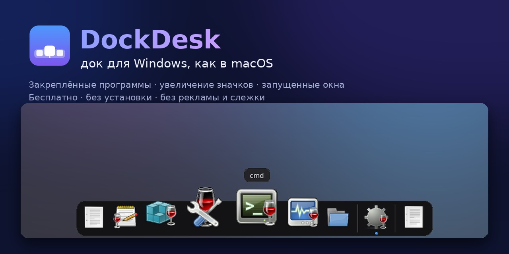

  
   Скачивается сразу ZIP с последней версией · <a href="https://github.com/NikoliniOFF/DockDesk/releases">Все версии</a>

  
  
  

<h1 align="center">DockDesk для Windows</h1>

  <b>Док внизу экрана, как в macOS: любимые программы под рукой, значки плавно растут под курсором.</b> 
  Закрепите программы, папки и ярлыки, переключайтесь между окнами одним щелчком. Панель задач Windows по умолчанию прячется: часы, громкость и значки в трее остаются на доке. 
  Бесплатно · без установки · без рекламы · обновляется сама.

---

## ✨ Что умеет

| | |
|---|---|
| 🧲 **Док где удобно** | Внизу по центру, слева или справа. Полупрозрачный, поверх окон и над панелью задач. Может прятаться и выезжать, когда курсор касается края экрана. |
| 📌 **Закрепление** | Перетащите на док программу (.exe), ярлык или папку — она закрепится. Порядок меняется мышью, а чтобы убрать значок, вынесите его за пределы дока или выберите «Открепить» в меню. Сразу закреплены Проводник и браузер по умолчанию. |
| 🔍 **Увеличение** | Значки под курсором плавно растут, соседние — чуть меньше, как в macOS. Значки берутся в высоком разрешении, поэтому не размываются. Силу увеличения можно выбрать или выключить совсем. |
| 🪟 **Запущенные программы** | Под запущенной программой — точка, у активной она синяя. Незакреплённые программы появляются после разделителя. Щелчок — переключиться, ещё щелчок — свернуть; средняя кнопка — новое окно. Правый щелчок — список окон и «Закрыть». |
| 🗑️ **Корзина** | В конце дока: видно, пустая она или нет. Бросьте файл на корзину — он удалится в неё; правый щелчок — «Очистить корзину». |
| 🫥 **Без панели задач** | Можно спрятать панель задач Windows. Она вернётся, когда вы выключите настройку или выйдете из DockDesk, — даже если программа закрылась аварийно. |
| 🎮 **Не мешает играм** | Над полноэкранными играми и видео док уходит с экрана сам. |
| 🪶 **Лёгкий** | Одна маленькая программа. Без движения мыши DockDesk не тратит процессор: кадры рисуются только во время анимации, а за окнами следят события Windows, без опроса. |
| 🌗 **Светлая и тёмная тема** | Следует теме Windows или выбирается вручную. |

## 📸 Как это выглядит

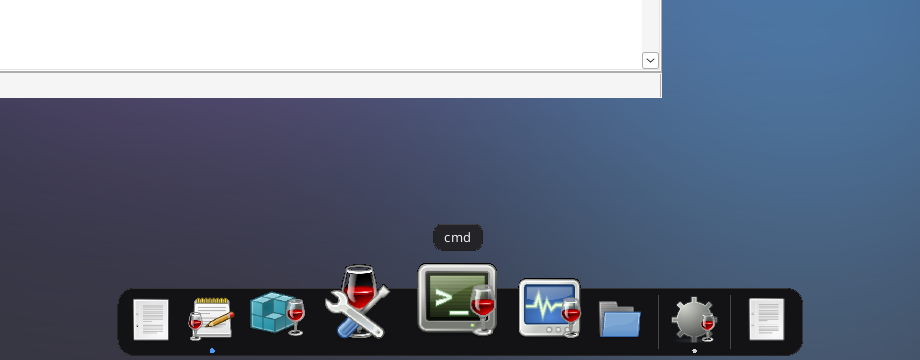

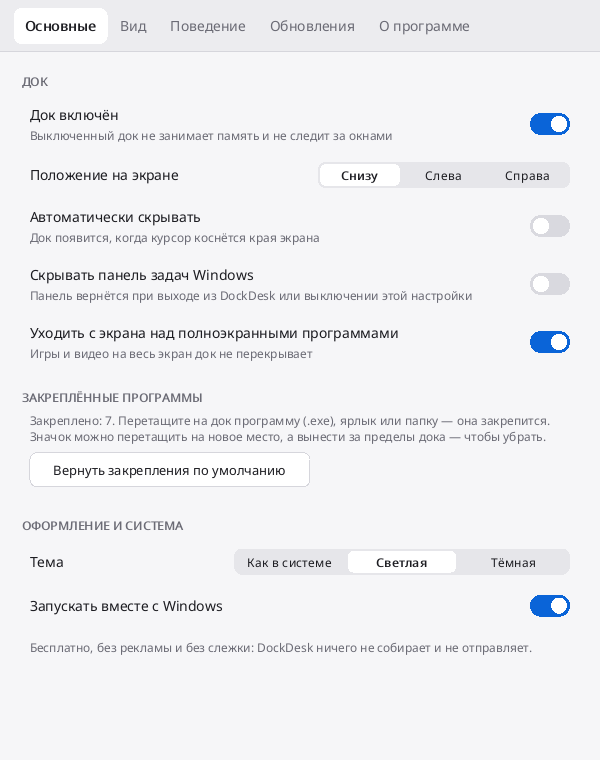 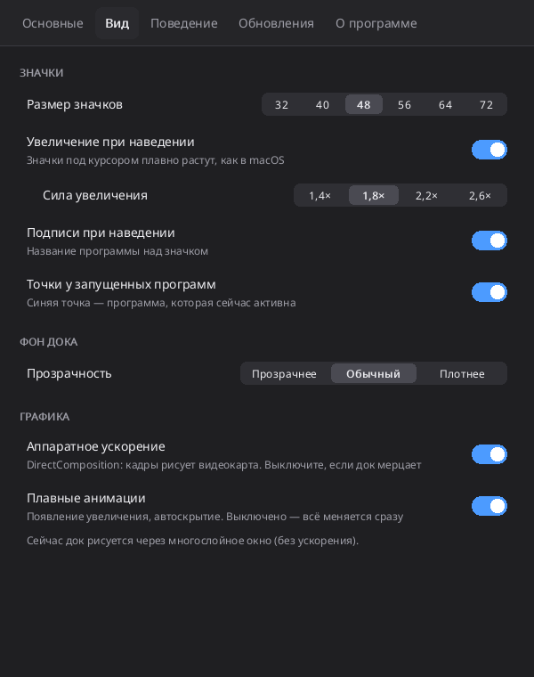

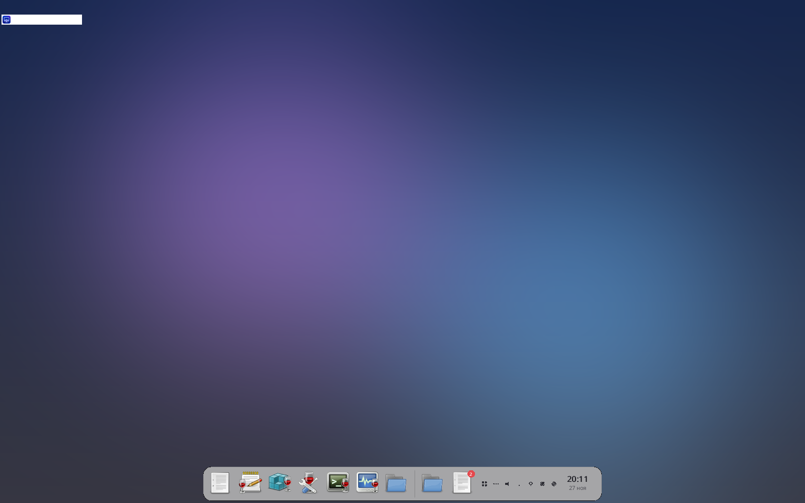

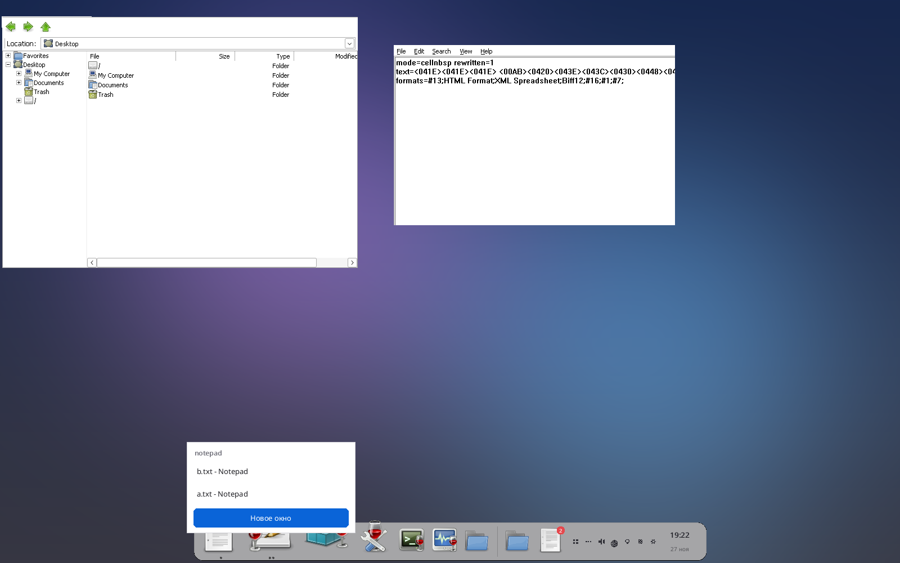 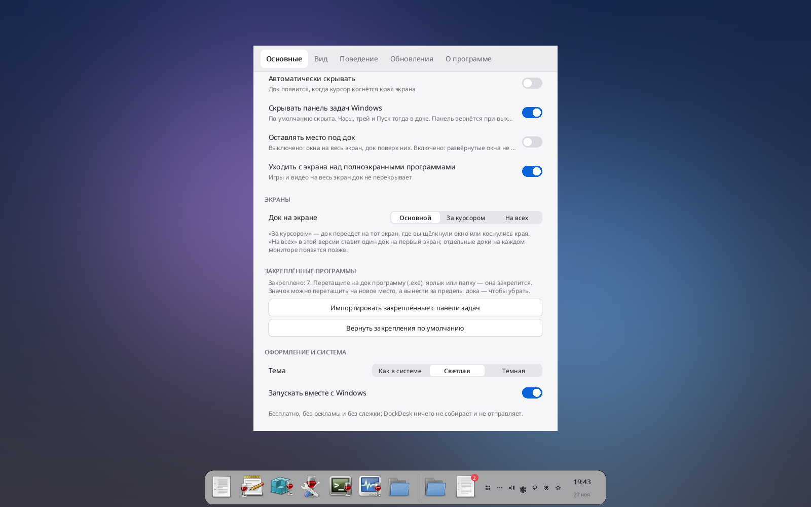

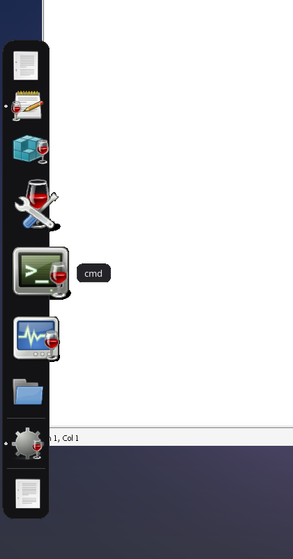 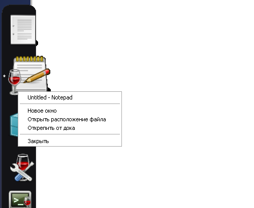

## 📥 Как установить

1. Скачайте **[DockDesk-win64.zip](https://github.com/NikoliniOFF/DockDesk/releases/latest/download/DockDesk-win64.zip)** (или выберите файл на странице [последней версии](https://github.com/NikoliniOFF/DockDesk/releases/latest)).
2. Распакуйте архив в постоянную папку, например `Документы\DockDesk`.
3. Запустите **DockDesk.exe** — внизу экрана появится док, а у часов — значок DockDesk.
4. Если Windows покажет синее окно *«Система Windows защитила ваш компьютер»*, нажмите **«Подробнее» → «Выполнить в любом случае»**.

> Устанавливать ничего не нужно: DockDesk — одна программа. Чтобы удалить, выберите «Выход» в меню значка и удалите папку.

## 🖱️ Мышь

| Действие | Что происходит |
|---|---|
| щелчок по значку | запустить программу или переключиться на её окно; если окон несколько — выбрать из списка; ещё щелчок — свернуть |
| средняя кнопка или <kbd>Shift</kbd>+щелчок | открыть новое окно программы |
| правый щелчок по значку | окна программы, «Новое окно», «Открыть расположение файла», «Закрепить» / «Открепить», «Закрыть все» |
| правый щелчок по пустому месту дока | настройки, положение на экране, увеличение, автоскрытие |
| перетащить файл на док | между значками — закрепить; на программу — открыть файл в ней; на корзину — удалить |
| перетащить значок | поменять порядок; вынести за пределы дока — открепить |

## ⚙️ Где настройки

Щёлкните значок DockDesk у часов (или правой кнопкой по пустому месту дока → «Настройки дока…»). Вкладки: «Основные», «Вид», «Поведение», «Обновления», «О программе». Закреплённые программы и настройки хранятся в `%APPDATA%\DockDesk\settings.ini`.

## ❓ Вопросы

<b>Windows пишет «Система Windows защитила ваш компьютер». Это вирус?</b>

Нет. Так Windows встречает любую новую программу без платной цифровой подписи. Нажмите «Подробнее» → «Выполнить в любом случае».

<b>Я спрятал панель задач. Как её вернуть?</b>

Выключите «Скрывать панель задач Windows» в настройках или выйдите из DockDesk через значок у часов. Если программа закрылась аварийно, панель вернётся при следующем запуске DockDesk.

<b>Куда делись часы и значки у часов (Discord, Steam)?</b>

Когда панель задач спрятана, часы, громкость, сеть, уведомления, «Пуск» и значки в трее живут на доке. Щёлкните часы, чтобы открыть календарь, или кнопку трея, чтобы открыть скрытые значки.

<b>Док пропал после включения аппаратного ускорения. Что делать?</b>

Начиная с версии 1.0.2 DockDesk сам переключается на обычную отрисовку, если видеокарта не справилась. Причину можно посмотреть в файле `%APPDATA%\DockDesk\DockDesk.log`. Аппаратное ускорение можно выключить в настройках.

<b>При включении дока прыгают значки на рабочем столе?</b>

В 1.0.3 DockDesk больше не меняет рабочую область экрана, если вы не включили «Оставлять место под док». Панель задач прячется иначе, а позиции значков при необходимости возвращаются на место.

<b>Панель задач всё равно выезжает, если навести курсор вниз</b>

Обновитесь до 1.0.3: панель прячется целиком и не должна выезжать от курсора у края. Вернуть её можно выключателем в настройках или выходом из DockDesk.

<b>Не будет ли тормозить компьютер?</b>

Нет. Пока вы не наводите мышь на док, DockDesk ничего не рисует и ничего не опрашивает. Выключенный док не занимает память под графику и не следит за окнами.

<b>Программа что-нибудь собирает или отправляет?</b>

Нет. В интернет DockDesk обращается лишь к GitHub, чтобы проверить обновления, — это можно выключить.

## 🧩 Другие программы от Nikolini

<table>
  <tr>
    <td width="96" align="center"><a href="https://nikolinioff.github.io/HubDesk/">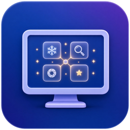</a></td>
    <td>
      <b><a href="https://nikolinioff.github.io/HubDesk/">HubDesk</a></b> — все программы Nikolini в одном окне: установка, включение, автозапуск и обновления галочками. 
      <a href="https://nikolinioff.github.io/HubDesk/">Сайт</a> · <a href="https://github.com/NikoliniOFF/HubDesk">GitHub</a>
    </td>
  </tr>
  <tr>
    <td width="96" align="center"><a href="https://nikolinioff.github.io/WinterDesk/">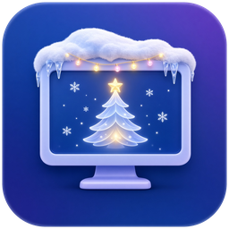</a></td>
    <td>
      <b><a href="https://nikolinioff.github.io/WinterDesk/">WinterDesk</a></b> — снег на рабочем столе Windows: сугробы на окнах, гирлянды, ёлочка и отсчёт до Нового года. 
      <a href="https://nikolinioff.github.io/WinterDesk/">Сайт</a> · <a href="https://github.com/NikoliniOFF/WinterDesk">GitHub</a>
    </td>
  </tr>
  <tr>
    <td width="96" align="center"><a href="https://nikolinioff.github.io/PeekDesk/">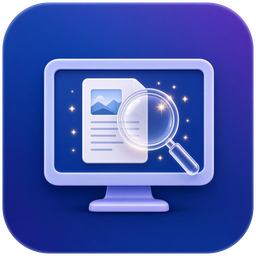</a></td>
    <td>
      <b><a href="https://nikolinioff.github.io/PeekDesk/">PeekDesk</a></b> — предпросмотр файлов по пробелу в Проводнике Windows, как Quick Look в macOS. 
      <a href="https://nikolinioff.github.io/PeekDesk/">Сайт</a> · <a href="https://github.com/NikoliniOFF/PeekDesk">GitHub</a>
    </td>
  </tr>
  <tr>
    <td width="96" align="center"><a href="https://nikolinioff.github.io/SnapDesk/">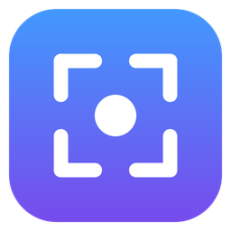</a></td>
    <td>
      <b><a href="https://nikolinioff.github.io/SnapDesk/">SnapDesk</a></b> — скриншоты и запись экрана по горячей клавише, как в macOS: миниатюра в углу, которую можно перетащить в Discord. 
      <a href="https://nikolinioff.github.io/SnapDesk/">Сайт</a> · <a href="https://github.com/NikoliniOFF/SnapDesk">GitHub</a>
    </td>
  </tr>
  <tr>
    <td width="96" align="center"><a href="https://nikolinioff.github.io/SpotDesk/">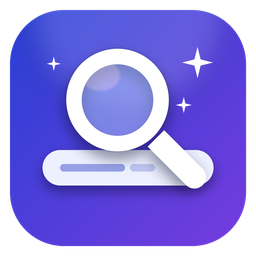</a></td>
    <td>
      <b><a href="https://nikolinioff.github.io/SpotDesk/">SpotDesk</a></b> — быстрый поиск по Alt+Space в Windows, как Spotlight в macOS: программы, файлы, калькулятор и курсы валют. 
      <a href="https://nikolinioff.github.io/SpotDesk/">Сайт</a> · <a href="https://github.com/NikoliniOFF/SpotDesk">GitHub</a>
    </td>
  </tr>
  <tr>
    <td width="96" align="center"><a href="https://nikolinioff.github.io/IslandDesk/">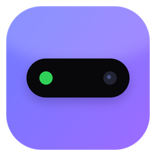</a></td>
    <td>
      <b><a href="https://nikolinioff.github.io/IslandDesk/">IslandDesk</a></b> — «Динамический остров» для Windows: музыка, громкость, таймер, загрузки и уведомления в живой пилюле вверху экрана. 
      <a href="https://nikolinioff.github.io/IslandDesk/">Сайт</a> · <a href="https://github.com/NikoliniOFF/IslandDesk">GitHub</a>
    </td>
  </tr>
  <!-- Новая программа: скопируйте строку <tr>…</tr> выше и поменяйте значок, название, описание и ссылки. -->
</table>

Все программы — на [github.com/NikoliniOFF](https://github.com/NikoliniOFF).

## 💬 Обсуждение

- 💡 [Предложить идею](https://github.com/NikoliniOFF/DockDesk/discussions/new?category=ideas)
- 🐞 [Сообщить о баге](https://github.com/NikoliniOFF/DockDesk/issues/new?template=bug.yml)
- 💬 [Все обсуждения](https://github.com/NikoliniOFF/DockDesk/discussions)

---

DockDesk · автор — <a href="https://github.com/NikoliniOFF">Nikolini (NikoliniOFF)</a> · бесплатно и без рекламы

